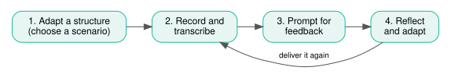

# The AI mentor {#sec-ai-mentor}

It is all very well knowing the techniques, but how do you put them into practice? Studies of autonomy-support training suggest that it works better when paired with practical instruction than with a lengthy exposition of theory [@reeve2024].

Given our capacity, we will use the autonomy-support knowledge base in an AI mentor. It is a practice partner: it gives quick, structured feedback on how you say something, so that you can reflect and try again. Treat its scores as a prompt for your own judgement rather than as a verdict.

## The four-step drill

{fig-alt="The four-step drill: adapt a structure, record and transcribe, prompt for feedback, reflect and adapt, then deliver it again from the recording step."}

### Step 1: Adapt a structure {#sec-step-scenario}

Choose a moment with one student, a group or a whole class in which you deliver a structural element. Some scenarios are much harder than others. Whichever you choose, it must keep its structure. It cannot collapse into "we all do what we want".

::: {.callout-note appearance="simple"}
Be autonomy-supportive towards yourself here: pick the scenario you actually care about or want to grow in, not the one that will score best.
:::

Basic scenarios include:

- **Introducing something:** a new learning activity, an abstract concept or a class rule or policy.
- **When students:** complain, sit passively without participating or do not submit an assignment.
- **Harder asks:** people speak at the back, you are describing a complex assignment or you are outlining behavioural expectations.

More abstractly, you can take any element of structure and deliver it:

| Element | Examples |
|---|---|
| **Aims** | expectations, rules, goals, directions, schedule, plan, challenge, standard, priority, script, to-do list |
| **Means** | guidance, mentoring, scaffolding, modelling, coaching, help, suggestions, examples, encouragement, reminders, tips |
| **Appraisal** | feedback, grades, rewards, praise, corrective feedback, assessment, strengths, weaknesses, points, post-performance analysis |
: {tbl-colwidths="[30,70]"}

### Step 2: Record and transcribe {#sec-step-record}

Say the scenario aloud the way you would say it in the room. Warm up first if that helps. The first take is meant to be your ordinary delivery, so be naturalistic.

The transcribe function in MS Word works well for getting the written transcript, if you have access to it. Later you can experiment with the format: audio, video, a longer delivery or something from your own archive.

::: {.callout-important}
## Consent and data protection

If a recording involves real students, check your consent and data-protection. For the mentoring practise, deliver to an empty room or to the person next to you, so that no student data are involved at all. You are transcribing yourself, not your students.
:::

### Step 3: Prompt for feedback {#sec-step-prompt}

1. Open a **fresh** Copilot chat.
2. Paste in the prompt (full text bellow).
3. Paste your transcript beneath it.
4. Attach the two background articles (called Article1 and Article2 in the prompt).

> Using the information in the uploaded Word files Article1 and Article2 that describe and explain what autonomy-supportive teaching is to show what autonomy-supportive teaching looks like in classroom practice, evaluate the following transcript from a teacher to answer two questions. First, using a scale from 1 to 7 where 1 = not at all and 7 = extremely, how would you score the teacher in the following transcript in terms of (0) overall autonomy-supportive teaching, (1) perspective taking, (2) interest support, and (3) value support? To report those four scores, create an easy-to-read landscape-formatted table with three columns labelled Aspect, Rating (1-7), and Justification and four rows labelled Overall AST, (1) Perspective Taking, (2) Interest Support, and (3) Value Support. For the Justification entries, explain why you gave the teacher each score. Next, after that table, provide two 'Recommendations for Improvement' for what the teacher in the following transcript could do differently to earn a higher overall score on autonomy-supportive teaching. Overall, limit the number of words used to produce this feedback to 150 words or less:

Provide the AI mentor with these two articles:
- @reeve2021
- @reeve2024

The prompt asks the AI to score your transcript from 1 to 7 on four things, then to give two recommendations, in 150 words or fewer:

| Score | Aspect |
|---|---|
| 0 | Overall autonomy-supportive teaching |
| 1 | Perspective taking |
| 2 | Interest support |
| 3 | Value support |

**Practicalities**

:::: {.tiles}
::: {.tile}
Use Copilot or which ever enterprise-version your institution has, because it is GDPR-compliant.
:::
::: {.tile}
Use the fast model, for a quick turnaround.
:::
::: {.tile}
Use one fresh chat per attempt, so that takes do not contaminate each other.
:::
::::

### Step 4: Reflect and adapt {#sec-step-reflect}

Reflect critically on the feedback you received and choose one or two improvements. Then deliver the same scenario again, this time using autonomy-supportive practices, and aim for a higher score on the next pass.

Use the technique list as your menu:

| Heading | Technique |
|---|---|
| Perspective taking | 1. Take the student's perspective |
| Interest support | 2. Present learning activities in need-satisfying ways |
| Value support | 3a. Acknowledge and accept negative feelings 3b. Provide explanatory rationales 3c. Use invitational language *(3d. Display patience: bonus)* |

The next chapter shows what the loop looks like in practice.
