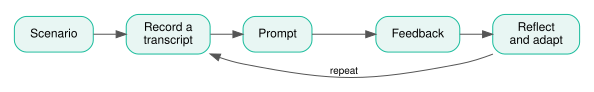

# Exercises {#sec-practice}

{fig-alt="The practice loop: scenario, record a transcript, prompt, feedback, reflect and adapt, then repeat from the recording."}

## Part I: free practice {#sec-practice-free}

Take a scenario of your own choosing from the list in @sec-ai-mentor and run it through the four steps of the drill.

1. Choose the scenario.
2. Record and transcribe your delivery.
3. Paste the prompt, your transcript and the two articles into a fresh Copilot chat.
4. Reflect on the feedback and pick one or two improvements.
5. Deliver it again.

## Part II: Specific task {#sec-practice-task}

If you wish to practise this with the kind of content I would deliver, try explaining this R Data Skills content: [psyteachR](https://psyteachr.github.io/data-skills-v4/03-stroop-analysis.html#calculating-summary-statistics). The assignment is to explain why `group_by()` and `summarise()` sometimes need to be used together, as opposed to `count()`. See the relevant chapter.

1. Run a couple of iterations of the drill.
2. Reflect on the experience.